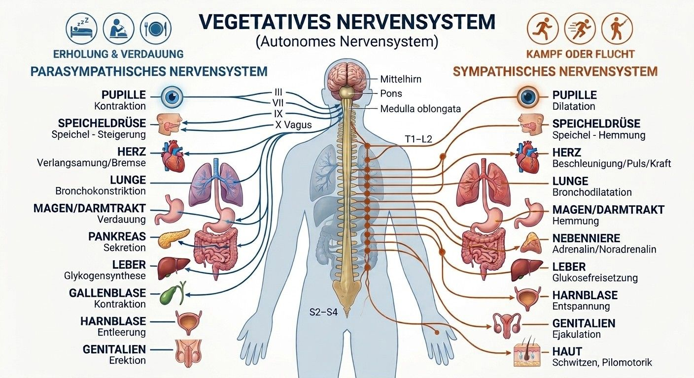

## Das vegetative Nervensystem – autonomer Regler für innere Balance

Das vegetative Nervensystem (= autonomes Nervensystem) regelt die Prozesse, die der Mensch nicht willentlich beeinflussen kann, d. h. es funktioniert ohne willentliche Steuerung. Dazu gehören unter anderem Herzschlag, Blutdruck und Verdauung.

Organisch wird das vegetative Nervensystem in den Sympathikus als anregenden Teil und den Parasympathikus als beruhigenden Teil untergliedert. Zusammen halten sie den Körper im Gleichgewichtszustand, um die Homöostase zu erhalten. Kommt es zu einem Ungleichgewicht zwischen den beiden Anteilen des vegetativen Nervensystems, sprechen wir von einer vegetativen bzw. autonomen Dysregulation (Dysautonomie).

Früher wurde dieses Beschwerdebild häufig als „vegetative Dystonie“ bezeichnet – ein Begriff, der oft abwertend im Sinne von „nichts Organisches gefunden“ verwendet wurde. Heute weiß man, dass es sich um eine echte Fehlregulation handelt, die sich messen und behandeln lässt.

<a href="/termine">Termin vereinbaren</a>

<figure class="infografik">

<figcaption>Parasympathikus und Sympathikus im Überblick – zum Vergrößern auf das Bild tippen.</figcaption>
</figure>

<h3>Sympathikus</h3>

Kämpfen und Flüchten

<ul>
<li>Erweiterung der Pupillen</li>
<li>Aktivierung des Herz-Kreislauf-Systems (Beschleunigung der Herzfrequenz, Erhöhung des Blutdrucks)</li>
<li>Intensivierung der Atmung (Erweiterung der Bronchien und Verminderung von Bronchialschleim)</li>
<li>Verminderung der Verdauung (verminderte Sekretion von Verdauungssäften, z. B. Speichel, verminderte Darmbewegung)</li>
<li>an der Haut Verengung der Blutgefäße, Schweißsekretion, Aufstellen der Haare</li>
<li>Geschlechtsorgane (Gefäßverengung, Ejakulation)</li>
</ul>

<h3>Parasympathikus</h3>

Ruhen und Verdauen

<ul>
<li>Verengung der Pupillen</li>
<li>Beruhigung des Herz-Kreislauf-Systems (Verlangsamung der Herzfrequenz, Senkung des Blutdrucks)</li>
<li>Beruhigung der Atmung (Verengung der Bronchien und Vermehrung von Bronchialschleim)</li>
<li>Intensivierung der Verdauung (vermehrte Sekretion von Verdauungssäften, z. B. Speichel, vermehrte Darmbewegung)</li>
<li>keine Wirkung auf Blutgefäße und Schweißsekretion der Haut</li>
<li>Geschlechtsorgane (Gefäßerweiterung, Erektion)</li>
</ul>

Sympathikoton – parasympathikoton: Beide Zustände führen zu einem Wechsel zwischen Anspannung und Entspannung und sind idealerweise im Gleichgewicht.

## Von Stress zur Dysregulation

Eine Stressreaktion des Körpers geht mit einer Sympathikusaktivierung einher und ist normal und an sich nicht gesundheitsschädigend – manchmal sogar eher ein angenehmes und leistungssteigerndes Erleben (Prüfung, Besprechung etc.). Das Problem in der heutigen Zeit liegt in der Übererregung des Sympathikus und der damit einhergehenden unzureichenden Regenerierung vom Stress.

Der dauerhafte Stressreiz führt zur Reaktion des Körpers auf muskulärer Ebene (Anspannung), hormoneller Ebene (Immunsystem) und vegetativer Ebene (Sympathikusaktivierung). Dies wiederum hat im zentralen Nervensystem Einfluss auf die Reizverarbeitung, die mit einer Senkung der Schmerzschwelle einhergeht, was zur Schmerzverstärkung führt. So entsteht ein Teufelskreis zwischen Stress und Schmerz. Zudem erhöht sich durch die durch Stress verursachte vegetative Dysregulation das Risiko für verschiedene Erkrankungen, wie zum Beispiel Diabetes, Herz-Kreislauf-Erkrankungen oder Depressionen.

Gerade bei chronischen [Rückenschmerzen](/rückenschmerzen), Nacken- und Gelenkbeschwerden lohnt sich deshalb ein Blick auf das vegetative Nervensystem: Ein dauerhaft aktivierter Sympathikus hält die Muskulatur unter Spannung und senkt die Schmerzschwelle – Beschwerden bleiben bestehen, obwohl Röntgen- oder MRT-Befunde sie nicht ausreichend erklären. Als Orthopäden und Schmerztherapeuten beziehen wir die vegetative Regulation daher in Diagnostik und Behandlung mit ein.

### Negative Auswirkungen von Stress auf vegetativ-hormoneller Ebene:

<ul class="symptomliste">
<li>Häufiges Schwitzen</li>
<li>Herz-Kreislauf-Beschwerden Hoher Blutdruck, Herzrasen, -stolpern</li>
<li>Atembeschwerden</li>
<li>Chronische Müdigkeit</li>
<li>Schnelles Erröten</li>
<li>Gastrointestinale Beschwerden Sodbrennen, Reizdarm</li>
<li>Schlafstörungen</li>
<li>Schwindelanfälle</li>
<li>Sexuelle Funktionsstörungen</li>
</ul>

Das Ziel ist es, ein Gleichgewicht zwischen Sympathikus und Parasympathikus wiederherzustellen.

## Dysautonomie bei POTS, nach Virusinfektionen und bei ME/CFS

Eine Dysautonomie kann nicht nur durch Dauerstress entstehen, sondern auch im Rahmen anderer Erkrankungen auftreten, zum Beispiel:

- **POTS (Posturales Tachykardiesyndrom):** Beim Aufstehen steigt der Puls übermäßig stark an (bei Erwachsenen um 30 Schläge pro Minute oder mehr), begleitet von Schwindel, Herzrasen, Benommenheit oder Erschöpfung.
- **Nach Virusinfektionen:** Vegetative Beschwerden wie Herzrasen, Kreislaufprobleme und Erschöpfung können über Monate anhalten.
- **ME/CFS (Myalgische Enzephalomyelitis/Chronisches Fatigue-Syndrom):** Häufig bestehen zusätzlich Zeichen einer autonomen Dysregulation, typisch ist die Verschlechterung nach Belastung (PEM).
- **Hypermobiles Ehlers-Danlos-Syndrom (hEDS):** Menschen mit [Hypermobilität bzw. hEDS](/hypermobilität) leiden gehäuft unter POTS und anderen Formen der Dysautonomie.

Diese Erkrankungen erfordern eine sorgfältige fachärztliche Abklärung, bei der organische Ursachen der Beschwerden ausgeschlossen werden.

## Wie wir das vegetative Nervensystem beeinflussen können

- **Medikamentös:** nach ärztlicher Verordnung sowie Infusionstherapien, z. B. [Procain-Basen-Infusionen](/leistungen-2/procainbasen-infusion)
- **Hydrotherapie:** Wechsel von Wärmereiz und Kältereiz regen die Regulation an, z. B. Güsse, Wickel, Sauna, Wassertreten
- **Sport/Bewegung, Ausdauertraining:** z. B. Ergometertraining, Laufbandtraining, Walking/Nordic Walking
- **(Psychologische) Entspannungsverfahren:** Atemtherapie, PMR nach Jacobson, Autogenes Training, Qi Gong, Achtsamkeitstraining
- **Schlafhygiene:** regelmäßiger Wach-/Schlafrhythmus, angenehme und schlaffördernde Schlafumgebung (Temperatur, Licht, Geräusche) schaffen, Mittagsruhe (Nickerchen, „Siesta“) ideal 20 Minuten, max. 30 Minuten, sonst Gefühl der Schlappheit
- **Achtsames Essen und Trinken/gesunde Ernährung:** ausgewogene Ernährung, Wahrnehmen der eigenen Bedürfnisse (Hunger, Durst), Genießen, Mikronährstoffanalyse (Vitamine, Mineralstoffe und Spurenelemente), intermittierendes Fasten, Omega-3-Fettsäuren
- **Regulationsmedizin:** [Akupunktur](/akupunktur), Homöopathie, Sauerstofftherapie, [Manuelle Therapie](/manuelle-medizin), Osteopathie, Entgiftung, [Neuraltherapie](/neuraltherapie-2), Stimulation des Vagusnervs
- **Störfeldbehandlung mittels [eIRT](/irt-behandlung):** Nach dem Konzept der eIRT können zentral abgespeicherte alte Verletzungsmuster neben der Fehlansteuerung von Muskeln mit entsprechenden Beschwerden in den dazugehörigen Gelenken auch zu einer vegetativen Dysregulation beitragen. Diese osteopathisch-kinesiologische Therapie bieten wir in unserer Praxis an.

## Was Sie selbst tun können: den Vagusnerv aktivieren

Der Vagusnerv ist der wichtigste Nerv des Parasympathikus. Mit einfachen Übungen im Alltag lässt er sich anregen und die Entspannungsreaktion des Körpers unterstützen:

- **Langsames Atmen mit verlängerter Ausatmung:** z. B. 4 Sekunden ein- und 6 Sekunden ausatmen, mehrmals täglich für einige Minuten
- **Kältereize:** das Gesicht mit kaltem Wasser waschen oder kalt abduschen
- **Summen, Singen oder Gurgeln:** der Vagusnerv versorgt auch Kehlkopf und Rachen
- **Regelmäßige, moderate Bewegung** an der frischen Luft
- **Soziale Kontakte, Lachen und bewusste Pausen** im Alltag

## Wie man eine vegetative Dysregulation (Dysautonomie) messen oder feststellen kann

Mit Hilfe der [VNS-Analyse](/vns-analyse) können wir Veränderungen des vegetativen Nervensystems (vegetative Dysregulation) messen und unsere Therapien mit derselben Methode auch überprüfen, kontrollieren und wenn notwendig verändern. Ziel ist es, die Herzratenvariabilität (HRV) zu erhöhen und den Körper zu regenerieren.

### Was ist die Herzratenvariabilität (HRV)?

Das Herz schlägt nicht wie ein Metronom: Die Zeitabstände zwischen zwei Herzschlägen schwanken ständig um einige Millisekunden. Diese Schwankung heißt Herzratenvariabilität. Eine hohe HRV zeigt, dass sich der Körper flexibel an Belastung und Erholung anpassen kann und der Parasympathikus gut arbeitet. Eine dauerhaft niedrige HRV weist dagegen auf eine anhaltende Sympathikus-Dominanz hin, wie sie bei chronischem Stress und vegetativer Dysregulation auftritt.

Die VNS-Analyse misst die HRV schmerzfrei und ohne Nadeln. So lässt sich die vegetative Regulation messbar darstellen und der Verlauf unter der Therapie kontrollieren.

## Häufige Fragen

Was ist eine Dysautonomie?

Eine Dysautonomie (vegetative oder autonome Dysregulation) ist ein Ungleichgewicht zwischen Sympathikus und Parasympathikus, den beiden Teilen des vegetativen Nervensystems. Sie kann sich durch Beschwerden wie Herzrasen, Schwindel, Schlafstörungen, Verdauungsprobleme, Erschöpfung oder verstärkte Schmerzen äußern.

Ist eine Dysautonomie dasselbe wie eine „vegetative Dystonie“?

„Vegetative Dystonie“ ist ein älterer Begriff für ähnliche Beschwerden, der heute kaum noch verwendet wird. Der Begriff Dysautonomie beschreibt genauer, dass die Steuerung durch das autonome Nervensystem gestört ist – eine Fehlregulation, die sich messen und behandeln lässt.

Kann Stress Rückenschmerzen verursachen?

Ja, Stress kann Rückenschmerzen verstärken und unterhalten. Bei Dauerstress bleibt der Sympathikus aktiviert, die Muskulatur steht unter Spannung und die Schmerzschwelle sinkt. So kann ein Teufelskreis aus Stress und Schmerz entstehen.

Wie wird eine vegetative Dysregulation festgestellt?

Grundlage sind ein ausführliches Gespräch und die körperliche Untersuchung. Mit der VNS-Analyse wird zusätzlich die Herzratenvariabilität (HRV) gemessen, die die Aktivität von Sympathikus und Parasympathikus widerspiegelt. Organische Ursachen der Beschwerden sollten fachärztlich ausgeschlossen werden.

Was kann ich selbst gegen eine vegetative Dysregulation tun?

Hilfreich sind regelmäßige moderate Bewegung, Entspannungsverfahren, eine gute Schlafhygiene und Übungen, die den Vagusnerv aktivieren – etwa langsames Atmen mit verlängerter Ausatmung, Kältereize oder Summen. Wichtig ist außerdem eine ausgewogene Ernährung mit einer ausreichenden Zufuhr von Nährstoffen, Vitaminen und Mineralstoffen. Liegt ein Mangel vor, z. B. an <a href="/vitamin-d-info">Vitamin D</a> oder Magnesium, sollte dieser gezielt ausgeglichen werden – am besten nach einer Laboranalyse.

<strong>Individuelle Behandlung</strong>Abgestimmt auf Ihre Beschwerden

<strong>Ganzheitlicher Ansatz</strong>Wir betrachten nicht nur Symptome, sondern suchen auch nach möglichen Ursachen

